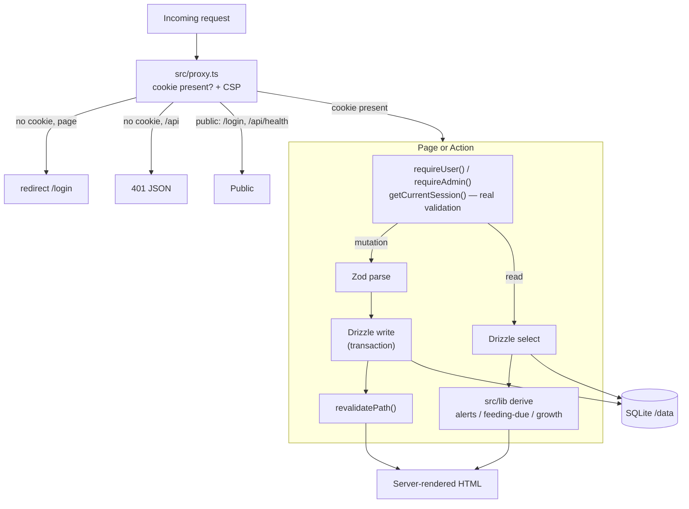

# Architecture

How the Kitten Foster Tracker is put together and why. Pair this with
[DECISIONS.md](DECISIONS.md) for the reasoning behind each major choice.

## Components

| Component | One-liner |
|---|---|
| **`src/proxy.ts`** | First code each request hits — optimistic cookie auth gate + per-request CSP nonce. Runs before Node code, so no DB access. |
| **Server Components** | Render authenticated pages on the server, reading directly from the DB via Drizzle. |
| **Server Actions** | Handle every mutation (`"use server"`): guard → Zod → Drizzle → revalidate. |
| **Route handlers** (`src/app/api`, `src/app/export`) | Non-page HTTP: photo upload/serve, health check, PDF export. |
| **`src/lib`** | Pure domain logic (alerts, feeding, schedule, growth) with no framework/DB imports. |
| **`src/lib/auth`** | Session lifecycle, password hashing, per-IP rate limiting, request guards. |
| **`src/db`** | Drizzle schema, singleton connection, boot-time migrate + seed. |
| **SQLite** (`/data` volume) | Embedded database, WAL mode, foreign keys on. |
| **Photo store** (`/photos` volume) | Re-encoded WebP files with UUID names, served only through an authed route. |

## Request & data flow

**Two-layer auth.** The proxy does a cheap, optimistic check (does a session cookie exist?)
because it runs in the edge bundle without DB access. The real check —
`getCurrentSession()` validating the token's HMAC against the `sessions` table — happens
inside every page loader and server action via `requireUser()` / `requireAdmin()`. A forged
cookie passes the proxy but fails validation.

**Derive-on-read.** Alerts, growth slopes, and "feeding due" times are *not* stored. They're
recomputed at render time from the raw `weight_entries` / `feedings` rows plus live
`alert_settings`. This keeps the data model simple and means a settings change instantly
re-colors every kitten without a migration or backfill.

## How components communicate

| Path | Mechanism | Sync/async |
|---|---|---|
| Browser ↔ app | HTTPS (via NPM), then HTTP inside the `kitten_proxy` Docker network | Async over the wire |
| Form ↔ server | React Server Actions (RPC-style `FormData` POST) | `async` action, `await`ed |
| App ↔ SQLite | `better-sqlite3` via Drizzle | **Synchronous** — better-sqlite3 is a sync, in-process driver |
| Page → domain logic | Direct function calls into `src/lib` | Sync, pure |
| Upload pipeline | Route handler → `sharp` re-encode → filesystem | Async |
| Cache refresh | `revalidatePath()` after writes | Sync call, async re-render |

There is no message queue, background worker, or external API call in the request path —
everything resolves within a single request.

## External integrations

| Integration | Role |
|---|---|
| **Nginx Proxy Manager (NPM)** | HTTPS termination and the *only* network path to the app. The container publishes no host port; NPM reaches it over the shared `kitten_proxy` Docker network. HTTPS-only is therefore structural, not a setting. |
| **Pi-hole (LAN DNS)** | Resolves the app hostname to NPM's LAN IP for local access. |
| **Docker volumes** | `/data` (SQLite) and `/photos` are the only writable paths; the root filesystem is read-only. |
| **Host cron** | Runs `scripts/backup.sh` nightly (online-safe `VACUUM INTO` + photos tarball). |

No third-party SaaS, analytics, or outbound network calls — the app is self-contained by design.

## Scaling considerations & limitations

- **Single-node by design.** SQLite + a singleton in-process connection means the app runs
  as **one container** with one writer. This fits a single foster household / small shelter
  (handfuls of concurrent users) and is the right trade for simplicity and zero ops. It does
  **not** horizontally scale — you cannot run multiple replicas against the same file.
- **Vertical headroom is large.** WAL mode allows concurrent reads during writes; thousands
  of kittens and tens of thousands of weight/feeding rows are trivial for SQLite.
- **Derive-on-read cost** grows with history per kitten, but alert/growth windows are bounded
  (e.g. 48h for alerts), so per-render work stays small.
- **Backups are the durability story** — there's no replication. Nightly `VACUUM INTO` plus
  off-box copies (see root README) are the recovery plan.
- **Photos live on a local volume**, not object storage; capacity is bounded by host disk.

If multi-tenant or multi-replica scale were ever needed, the migration path would be Drizzle
→ Postgres (Drizzle abstracts the dialect), an external session store, and S3-style photo
storage. That is explicitly out of scope for the current single-household use case.
