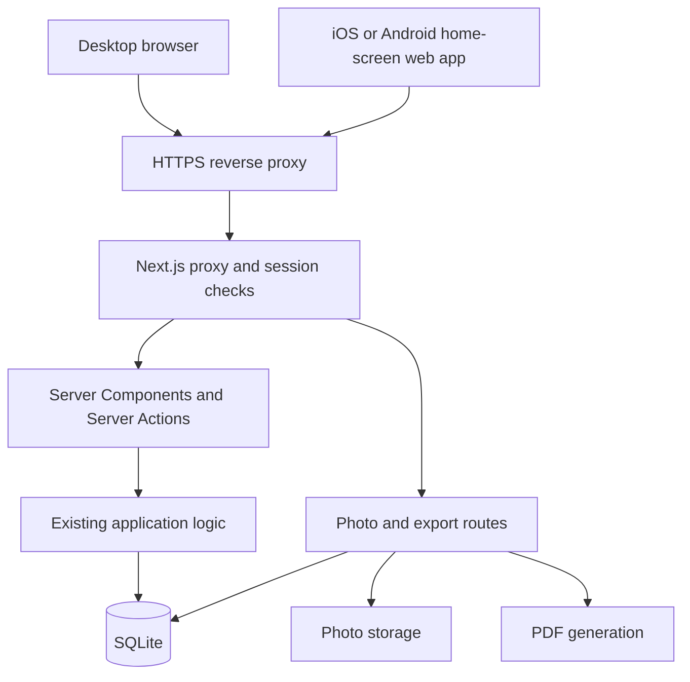

# Mobile web app: release specification

Status: planned. This document defines future work. It does not describe a completed release.

## Goal

Users can install Kitten Tracker on iOS and Android and complete the existing care tasks through the home-screen app.

Release 1 uses the existing web interface and server. It requires a connection to the server.

## Scope

Release 1 includes:

- A web app manifest, installation icons, and standalone display settings.
- Installation instructions for iOS and Android.
- Mobile navigation, forms, charts, photo uploads, and PDF downloads.
- A clear connection message during an open session after connection loss.
- Automated checks and real-device acceptance checks.

Release 1 excludes:

- App Store and Google Play distribution.
- A native container or React Native interface.
- Push notifications and background reminders.
- Offline records, queued writes, and data synchronization.
- A new mobile API, database schema, or public server exposure.

## Architecture



The Next.js standalone server remains the application server. The phone does not contain a database or a second application server.

The existing HTTPS origin remains the installation origin. Remote use requires the existing VPN or another authorized network route.

Server Actions continue to handle forms. Existing server access checks, validation, and transactions remain authoritative.

Release 1 does not require a service worker. Use an online interface without an application-managed offline cache.

Do not store records, photos, PDFs, credentials, or pending writes in Cache Storage, IndexedDB, or local storage.

Normal browser behavior is separate from application-managed caching. Inspect response headers and logout behavior for private content.

An open page can show connection status. A cold start without a connection can show the browser's network error.

Do not promise an offline startup screen in this release. A custom offline startup screen requires a separate cache design.

## Implementation boundaries

The installation agent owns the manifest, icons, root metadata, and installation instructions.

The mobile interface agent owns navigation and approved presentation changes. This agent also owns the connection message.

The verification agent owns mobile regression scripts and the test report. The lead owns integration and shared settings.

The current proxy redirects anonymous manifest requests to login. Allow the exact manifest route without opening protected application routes.

Preserve the nonce-based Content Security Policy. Do not weaken access checks or enable broad public path exceptions.

Use the existing brand assets. Keep desktop behavior and shared medical and adoption rules intact.

Do not extract a new application layer unless a release requirement needs it. A future mobile API can reuse shared server operations.

Read the relevant guides in `node_modules/next/dist/docs/` before implementation:

- `01-app/02-guides/progressive-web-apps.md`
- `01-app/03-api-reference/03-file-conventions/01-metadata/manifest.md`

## Acceptance checks

| ID  | Required result                                                                                 | Evidence                                   |
| --- | ----------------------------------------------------------------------------------------------- | ------------------------------------------ |
| M01 | Anonymous clients receive the manifest and icons without a login redirect.                      | HTTP and browser checks                    |
| M02 | The home-screen app uses the correct name, icon, start URL, and standalone display.             | Real iPhone and Android checks             |
| M03 | Login, logout, session expiry, and relaunch behave correctly.                                   | Automated checks and device checks         |
| M04 | Navigation and forms work at 360px and 390px viewport widths.                                   | Browser checks                             |
| M05 | Users can submit weights, feeds, and kitten and mother medical records.                         | Synthetic-data regression checks           |
| M06 | Charts remain readable without page-wide horizontal overflow.                                   | Browser and device checks                  |
| M07 | Photo selection, supported HEIC uploads, and PDF downloads work.                                | Real-device checks with synthetic files    |
| M08 | The keyboard does not hide required controls. Safe areas do not obscure navigation.             | Real-device checks                         |
| M09 | Connection loss shows a clear message in an open app. Recovery permits normal use.              | Browser and device checks                  |
| M10 | A failed submission does not claim success or retry automatically.                              | Failure-path checks                        |
| M11 | Viewer responses omit protected contact fields. Protected routes still reject anonymous access. | Access regression checks                   |
| M12 | No application-managed private cache or offline write queue exists.                             | Code review and browser storage inspection |
| M13 | Desktop workflows and existing production checks pass.                                          | Integrated check results                   |

For M10, an interrupted response can leave the write result unknown. Explain the uncertainty and ask users to inspect the record before resubmission.

The connection message must not claim server reachability from `navigator.onLine` alone. Request errors remain authoritative for submission results.

## Verification and release

Use synthetic records and synthetic photo files. Never copy production data into a test environment.

Run these checks against the combined change:

```bash
npm run typecheck
npm run lint
npm run test
./verify-prod.sh all
```

Register the mobile regression target in `verify-prod.sh`, including its seed mapping and `ALL_TARGETS` entry.

Keep the server in UTC and the browser in a different timezone. Preserve the existing datetime input behavior.

Use real iOS Safari and Android Chrome devices over HTTPS for installation checks. Browser emulation does not prove installation behavior.

Record the OS version, browser version, commit, result, and limitations for each device check.

Use a separate HTTPS test instance with synthetic data for device checks. Give devices an authorized network route to that instance.

Mark unavailable device checks as pending. Do not report pending checks as passed.

The lead can mark the release ready only after all acceptance checks pass. Deployment remains a separate task.

## Delivery order

1. Establish a fresh base revision and record existing local changes.
2. Assign the [agent briefs](MOBILE_AGENT_BRIEFS.md) and exact file ownership.
3. Start installation and mobile interface work in separate worktrees.
4. Prepare verification cases in parallel.
5. Combine changes and complete automated verification.
6. Complete real-device acceptance checks.
7. Record the release result and remaining limitations.

## Later releases

Notifications require subscription storage, a scheduled process, delivery rules, and privacy controls.

A dedicated mobile interface requires an API and a mobile session design. It can reuse the existing database and shared application operations.

Offline writes require local storage, operation identifiers, retry rules, and conflict rules. Define medical corrections and adoption conflicts before implementation.

## Related documents

- [Agent briefs](MOBILE_AGENT_BRIEFS.md)
- [Repository instructions](../AGENTS.md)
- [Current architecture](ARCHITECTURE.md)
- [Production runbook](../README.md)
