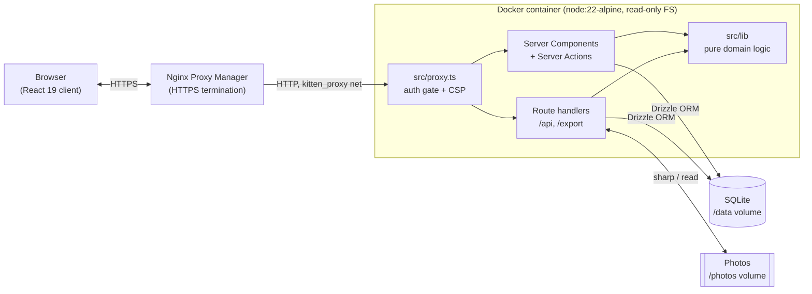

# Kitten Foster Tracker — Documentation

A self-hosted web app for tracking foster kittens from intake to adoption. It records
mothers and litters, the foster status pipeline, weights with growth charts and
neonatal alerts, hand-feeding schedules and countdowns, vaccinations, photo galleries,
and a shelter-ready PDF/print export. It runs in Docker behind Nginx Proxy Manager on a
home server, LAN-only, but is built so it can safely face the internet later.

> New here? Read [SETUP.md](SETUP.md) to get running, then [ARCHITECTURE.md](ARCHITECTURE.md)
> for the mental model, then [PROJECT_STRUCTURE.md](PROJECT_STRUCTURE.md) to find your way
> around the code.

---

## System architecture



---

## Key dependencies and their roles

| Dependency | Role |
|---|---|
| **next** `16.2.9` | App Router framework — UI, Server Components, Server Actions, and route handlers in one codebase. **Note: this is a customized Next.js build — see [AGENTS.md](../AGENTS.md).** |
| **react / react-dom** `19` | UI rendering, including Server Components. |
| **drizzle-orm** + **better-sqlite3** | Type-safe SQL over an embedded SQLite database. No separate DB server. |
| **drizzle-kit** | Generates SQL migrations from `src/db/schema.ts`. |
| **zod** `4` | Validates every mutation server-side before it touches the database. |
| **@node-rs/argon2** | Argon2id password hashing for user accounts. |
| **radix-ui** + **shadcn** + **tailwindcss** `4` | Accessible component primitives and styling. |
| **recharts** | Growth charts (weight over time, with reference bands). |
| **sharp** + **heic-convert** + **exifr** | Photo pipeline: decode (incl. HEIC), read EXIF capture time, re-encode to WebP, strip GPS. |
| **pdfkit** | Shelter PDF export for a kitten or litter. |
| **lucide-react** | Icon set. |
| **playwright** (dev) | End-to-end test driver (`e2e-step*.mjs`). |

---

## High-level data flow

```
INPUT                          PROCESS                                OUTPUT
─────                          ───────                                ──────
Form submit / upload   →   proxy.ts cookie gate           →   Rendered page (RSC)
  (Server Action or          → requireUser()/requireAdmin()    Growth chart (Recharts)
   route handler)            → Zod validation                  Alert badges
                             → Drizzle write to SQLite         Feeding countdown
                             → revalidatePath()                PDF / print export
                             → (photos) sharp re-encode        Authenticated photo stream
```

Every write goes: **auth guard → Zod parse → Drizzle transaction → cache revalidation**.
Reads are computed on demand — alerts, growth slopes, and feeding-due times are derived at
render time from the stored rows, not persisted. See [ARCHITECTURE.md](ARCHITECTURE.md).

---

## Quick start

```bash
cp templates/.env.example .env          # then set SESSION_SECRET
openssl rand -hex 32                     # paste output as SESSION_SECRET in .env
npm install
npm run dev                              # http://localhost:3000 (DB auto-migrates on boot)
npm run create-user -- --username admin --role admin   # prompts for a password
```

Full instructions, prerequisites, and gotchas are in [SETUP.md](SETUP.md).

---

## Documentation map

| Doc | What it covers |
|---|---|
| [SETUP.md](SETUP.md) | Prerequisites, install order, env vars, verification, gotchas. |
| [ARCHITECTURE.md](ARCHITECTURE.md) | Components, data-flow diagram, communication patterns, scaling limits. |
| [PROJECT_STRUCTURE.md](PROJECT_STRUCTURE.md) | Annotated directory tree and import conventions. |
| [TYPES_AND_INTERFACES.md](TYPES_AND_INTERFACES.md) | Core types, function contracts, example payloads. |
| [DECISIONS.md](DECISIONS.md) | Architecture Decision Records — the "why". |
| [GLOSSARY.md](GLOSSARY.md) | Domain and technical terminology. |
| [ERROR_PATTERNS.md](ERROR_PATTERNS.md) | Common failures and how to fix them. |
| [HANDOFF_TEMPLATE.md](HANDOFF_TEMPLATE.md) | Prompt template for handing tasks to an AI agent. |

The root [README.md](../README.md) covers production deploy, backups, and the security/exposure runbook.
